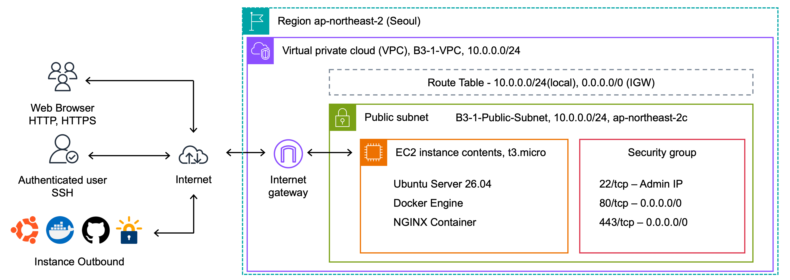
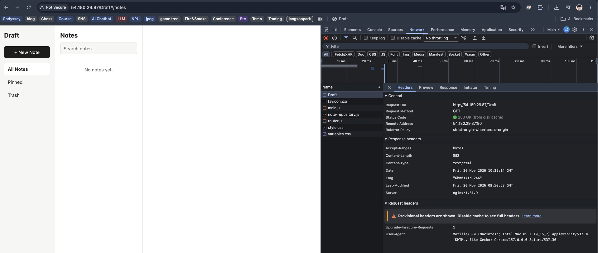

# aws-ec2-workflow

## Mission Overview


## AWS Infra Architecture




## Workflow

1. **Infrastructure Setup and Testing** - @jangsoopark-codyssey
  - asdf

2. **Documentation** - @Codex
  - asdf

3. **Review and Commit** - @jangsoopark-codyssey
  - asdf

## Quick Start

### Setup
```bash
$ git clone --recurse-submodules https://github.com/jangsoopark-codyssey/aws-ec2-workflow.git

$ cd aws-ec2-workflow
$ sudo apt update && sudo apt upgrade -y
$ chmod +x ./scripts/*.sh
$ ./scripts/install-docker-ubuntu.sh
$ exit 
```

### Test - Local Network

```bash
$ cd aws-ec2-workflow
$ ./scripts/run-docker.sh
$ docker ps

CONTAINER ID   IMAGE           COMMAND                  CREATED          STATUS          PORTS                                 NAMES
73ee9ddee7f9   draft-web:1.0   "/docker-entrypoint.…"   19 minutes ago   Up 19 minutes   0.0.0.0:80->80/tcp, [::]:80->80/tcp   draft-web

$ curl -i http://localhost/health
HTTP/1.1 200 OK
Server: nginx/1.31.9
Date: Fri, 20 Nov 2026 10:23:54 GMT
Content-Type: text/plain
Content-Length: 8
Connection: keep-alive

healthy
$ 
```

### Test - Public Network
```bash

$ curl -i http://{PUBLIC_IP}/health

HTTP/1.1 200 OK
Server: nginx/1.31.9
Date: Fri, 20 Nov 2026 10:27:46 GMT
Content-Type: text/plain
Content-Length: 8
Connection: keep-alive

healthy
```

