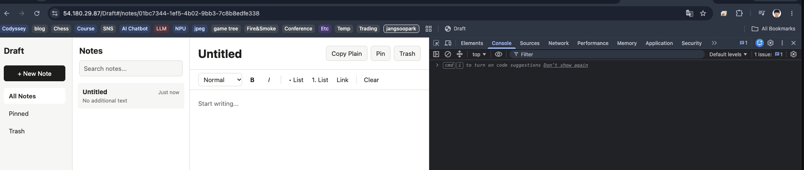

# aws-ec2-workflow

AWS VPC와 EC2를 활용해 웹 서비스 인프라를 구성하고, Docker 기반 Draft 배포부터 외부 접속 검증, HTTPS 적용, 리소스 정리까지 수행한 실습 기록.

> **실습 종료:** EC2와 실습용 VPC 리소스는 정리 완료로 기록되어 있다. 아래 IP와 접속 결과는 실습 당시의 기록이며 현재 서비스 주소가 아니다. 이 README는 저장된 문서·캡처·응답 기록을 기준으로 작성했다.

## Mission Overview

- 서울 리전에 사용자 지정 VPC와 퍼블릭 서브넷 구성
- Internet Gateway와 기본 경로를 통한 인바운드·아웃바운드 통신 구성
- Ubuntu EC2에 Docker Engine을 설치하고 NGINX 컨테이너로 Draft 서비스 제공
- 내부·외부 `/health` 응답 및 브라우저 접속 검증
- HTTP 환경의 노트 생성 오류를 HTTPS 적용으로 해결
- 실습 증빙 저장 후 EC2·스토리지·네트워크 리소스 정리

## AWS Infra Architecture


| 항목 | 실습 구성 |
|:---|:---|
| Region / AZ | 서울 `ap-northeast-2` / `ap-northeast-2c` |
| VPC | `B3-1-VPC`, `10.0.0.0/24` |
| Public Subnet | `B3-1-Public-Subnet`, `10.0.0.0/24` |
| Internet Gateway | `B3-1-IGW`, 실습 VPC에 연결 |
| Route Table | Main 테이블 사용, `10.0.0.0/24 → local`, `0.0.0.0/0 → IGW` |
| EC2 / Storage | Ubuntu Server 26.04, `t3.micro`, EBS 8 GiB |
| Public IPv4 | 자동 할당 주소 사용, Elastic IP 별도 할당 없음 |
| Web service | Docker Engine → `draft-web:1.0` → NGINX → Draft |
| HTTPS | Let’s Encrypt IP 주소 인증서, Certbot 갱신 타이머 구성 |

외부 요청은 Internet Gateway를 통해 EC2에 도달하며, 보안 그룹에서 접속 포트를 제어한다. 아웃바운드 통신은 패키지 설치, GitHub 저장소 복제, 컨테이너 이미지 다운로드 및 인증서 발급에 사용했다.

### Security Group

| 방향 | 포트 | 허용 범위 | 용도 |
|:---|:---|:---|:---|
| Inbound | TCP 22 | 관리자 공인 IP `/32` | SSH 관리 접속 |
| Inbound | TCP 80 | `0.0.0.0/0` | HTTP 및 인증서 발급 검증 |
| Inbound | TCP 443 | `0.0.0.0/0` | HTTPS 서비스 |
| Outbound | 기본 허용 | 기본 설정 | 외부 저장소 및 인증 기관 접속 |

리소스 작업에는 IAM 사용자를 사용하고 SSH 접근은 관리자 IP로 제한했다. 보안 그룹 설정 증빙: [규칙 화면 1](assets/images/03.aws-vpc-sg-1.png), [규칙 화면 2](assets/images/04.aws-vpc-sg-2.png).

## Workflow

1. **계정 및 네트워크 준비**: IAM, 서울 리전, VPC, 퍼블릭 서브넷, IGW, 라우팅과 보안 그룹 구성
2. **EC2 및 서비스 배포**: Ubuntu 인스턴스 생성 → SSH 접속 → Docker 설치 → Draft 이미지 빌드 및 컨테이너 실행
3. **접속 검증**: 컨테이너 실행 상태와 내부·외부 `/health`, 브라우저의 Draft 화면 확인
4. **HTTPS 적용**: HTTP 노트 생성 오류 분석 → IP 인증서 적용 → HTTPS에서 노트 생성 확인
5. **실습 종료**: 증빙 저장 → EC2 종료 → EBS·네트워크 리소스 정리 → Billing 확인

콘솔 구성과 배포 명령의 상세 절차는 [AWS VPC 및 EC2 생성·서비스 배포 기록](docs/aws-vpc-ec2-setup-and-deployment.md) 참고.

## HTTPS 적용

도메인과 Elastic IP 없이 EC2의 공인 IPv4를 대상으로 Let’s Encrypt IP 인증서를 발급해 적용했다. 실습 당시 Certbot 버전은 `5.10.0`, 인증서 프로필은 `shortlived`, 유효기간은 160시간(약 6일)이었다.

1. **사전 확인**: TCP 80·443 허용, Docker 실행 및 비밀번호 입력 없는 sudo 사용 가능 여부 확인
2. **인증서 발급**: 현재 공인 IP 확인 → 기존 컨테이너 일시 중지 → Certbot standalone 방식으로 IP 인증서 발급
3. **NGINX 적용**: 인증서 디렉터리 읽기 전용 마운트, 이미지 재빌드 및 설정 검사 후 80·443 포트로 컨테이너 재생성
4. **요청 처리**: HTTP `/health`는 `200 OK` 유지, 나머지 HTTP 요청은 HTTPS로 리다이렉트, HTTPS에서 TLS 1.2·1.3 사용
5. **자동 갱신**: `draft-certbot-renew.timer`로 12시간마다 갱신 필요 여부 확인, 갱신 전후 Hook으로 컨테이너 중지·재시작
6. **검증**: HTTPS 노트 생성, `/health` 응답, `certbot renew --dry-run` 성공 확인

갱신 시 standalone 검증을 위해 컨테이너가 일시 중지된다. Certbot 수동 실행과 타이머의 중복 실행을 피하고, 공인 IP 변경 시 새 IP에 맞는 인증서 발급이 필요하다. 상세 과정과 검증 명령은 [HTTPS 적용 기록](docs/https.md), 자동화 구현은 [적용 스크립트](scripts/enable-https-ip.sh) 참고.

## Verification Results

### Docker 및 내부 접속

기존 실습 응답 기록에서 `draft-web` 컨테이너의 `Up` 상태와 HTTP 포트 매핑을 확인했다. 아래는 **HTTPS 적용 전**의 `docker ps` 기록 일부다.

```text
IMAGE           STATUS          PORTS                                 NAMES
draft-web:1.0   Up 19 minutes   0.0.0.0:80->80/tcp, [::]:80->80/tcp   draft-web
```

실습 당시 EC2 내부와 외부 네트워크에서 각각 다음 방식으로 상태를 확인했다. `<public-ip>`는 실습 인스턴스 주소로 교체하는 자리표시자다.

```sh
# EC2 내부
curl -i http://localhost/health

# 외부 네트워크
curl -i 'http://<public-ip>/health'
```

두 요청의 기록된 결과는 `HTTP/1.1 200 OK`, 응답 본문은 `healthy`다. HTTPS 적용 후에도 HTTP `/health`는 유지하도록 구성했다.

### 외부 브라우저 및 HTTPS

| 검증 항목 | 실습 당시 주소·결과 | 근거 |
|:---|:---|:---|
| HTTP 웹 접속 | `http://54.180.29.87/Draft`, 브라우저 Network 화면에 `200 OK` 표시 | [HTTP 접속 캡처](assets/images/01.http.png) |
| HTTPS 노트 생성 | `https://54.180.29.87/Draft/#/notes`, 노트 생성 및 오류 해소 확인 | [HTTPS 화면](assets/images/05.https.png) |
| IP 인증서 | Let’s Encrypt 인증서 발급·적용 | [인증서 화면](assets/images/06.certificates.png) |
| 갱신 시험 | `certbot renew --dry-run` 성공, `draft-certbot-renew.timer` 구성 | [HTTPS 적용 기록](docs/https.md) |

HTTP 캡처의 `200 OK`는 브라우저의 디스크 캐시 응답 표시다. 별도로 남긴 외부 `/health` 요청 기록에서도 HTTP 200과 `healthy` 응답을 확인했다.



## Troubleshooting

**증상:** 공인 IP의 HTTP 주소에서 노트 생성 시 `crypto.randomUUID is not a function` 발생.

**원인 및 조치:** 보안 컨텍스트가 필요한 API를 HTTP 환경에서 호출한 문제로 분석했다. 도메인 없이 IP 주소 인증서를 발급하고 NGINX에 HTTPS를 적용한 뒤, HTTPS에서 노트 생성과 오류 해소를 확인했다.

인증서 갱신 시험 중 발생한 Certbot 동시 실행 문제도 중복 실행 종료 후 재시험으로 해결했다. 상세 오류와 화면은 [트러블슈팅](docs/troubleshooting.md), 갱신 구성과 Certbot 중복 실행 조치는 [HTTPS 적용 기록](docs/https.md) 참고.

## Cleanup and Cost

[리소스 종료 체크리스트](docs/cleanup-ckecklist.md)와 배포 기록 기준으로 다음 정리를 완료했다.

- EC2를 Stop이 아닌 Terminate로 종료: [EC2 화면](assets/images/07.terminate-ec2.png)
- EBS 볼륨 및 Elastic IP 잔존 여부 확인: [EBS 화면](assets/images/08.terminate-ebs.png), [Elastic IP 화면](assets/images/09.terminate-eip.png)
- 실습용 ENI, 보안 그룹, 서브넷, Internet Gateway, VPC 정리: [ENI 화면](assets/images/10.terminate-network-interface.png)
- NAT Gateway, Load Balancer, RDS 등 추가 리소스 잔존 여부 확인
- Billing에서 2026년 11월 예상액 **USD 0.22**, 상태 **Pending** 확인: [Billing 화면](assets/images/11.bills.png)

USD 0.22는 확인 당시의 예상액이며 최종 청구액이 아니다. 최종 청구서 확정 후 재확인 필요. 정리 체크리스트의 일시·증빙 경로 등 종료 결과 입력란과 전체 실습 체크리스트의 일부 표시는 아직 보완 대상이다.

## Repository Guide

| 경로 | 내용 |
|:---|:---|
| [실습 배포 기록](docs/aws-vpc-ec2-setup-and-deployment.md) | VPC·EC2 구성, Docker 배포, HTTPS, 검증 및 정리 절차 |
| [HTTPS 적용 기록](docs/https.md) | IP 인증서 발급, NGINX 적용, 자동 갱신과 검증 |
| [실습 체크리스트](docs/checklist.md) | 단계별 수행 항목 |
| [트러블슈팅](docs/troubleshooting.md) | HTTP 노트 생성 오류와 HTTPS 해결 기록 |
| [리소스 종료 체크리스트](docs/cleanup-ckecklist.md) | 삭제·잔존 리소스 확인 항목 |
| [용어 요약](docs/terminology.md) | AWS와 네트워크 용어 및 상세 문서 링크 |
| [scripts/](scripts/) | Docker 설치·실행 및 IP 인증서 적용 스크립트 |
| [docker/](docker/) | NGINX 이미지와 서비스 설정 |
| [Draft/](Draft/) | 웹 애플리케이션 서브모듈 |
| [assets/images/](assets/images/) | 접속·인증서·리소스 정리 증빙 |

### 재실습 시 확인

저장소와 서브모듈은 다음 명령으로 가져온다.

```sh
git clone --recurse-submodules https://github.com/jangsoopark-codyssey/aws-ec2-workflow.git
cd aws-ec2-workflow
```

현재 `docker/nginx.conf`에는 실습 당시 IP의 인증서 경로가 남아 있다. `scripts/run-docker.sh`는 기존 이미지 실행만 수행하며 빌드·인증서 마운트·443 포트 공개는 수행하지 않는다. 따라서 해당 스크립트만으로 최종 HTTPS 구성을 재현할 수 없다. 새 공인 IP, 인증서와 NGINX 설정, 포트 매핑을 확인하고 [상세 배포 기록](docs/aws-vpc-ec2-setup-and-deployment.md), [HTTPS 적용 기록](docs/https.md) 및 `scripts/enable-https-ip.sh`를 검토한 뒤 실행할 것.
