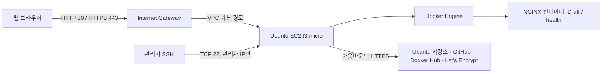

# AWS VPC 및 EC2 생성·서비스 배포 기록

서울 리전에서 사용자 지정 VPC와 퍼블릭 서브넷을 구성하고, Ubuntu EC2 인스턴스에 Docker와 NGINX를 설치해 Draft를 배포한 실습 기록이다. HTTPS 적용과 외부 접속 검증, 실습 종료 후 리소스 정리까지 포함한다.

> 이 문서는 실제 실습 구성을 바탕으로 작성했다. 실습은 종료되어 EC2와 VPC 리소스가 삭제되었다. 다시 구성할 때는 계정, 리전, AMI, 공인 IP, 로컬 파일 경로를 현재 환경에 맞게 확인한다.

## 1. 목표와 구성 요약

- AWS 리전: 서울 `ap-northeast-2`
- 웹 서비스: GitHub의 `jangsoopark-codyssey/Draft`
- 서비스 구성: Ubuntu EC2 → Docker Engine → NGINX 컨테이너
- 서비스 경로: `/Draft/`
- 상태 확인 경로: `/health`
- 외부 통신: Internet Gateway를 통한 EC2 인바운드·아웃바운드 통신
- HTTPS: 도메인 없이 Let’s Encrypt IP 주소 인증서 적용

| 리소스 | 실습 구성 |
|---|---|
| VPC | `B3-1-VPC`, `10.0.0.0/24` |
| Public Subnet | `B3-1-Public-Subnet`, `10.0.0.0/24`, `ap-northeast-2c` |
| Internet Gateway | `B3-1-IGW`, VPC에 연결 |
| Route Table | VPC의 Main 라우팅 테이블 사용, `0.0.0.0/0 → IGW` 경로 추가 |
| Security Group | `B3-1-Web-SG`; SSH는 관리자 공인 IP로 제한, HTTP/HTTPS는 외부 접속 허용 |
| EC2 | Ubuntu Server 26.04, `t3.micro`, EBS 8 GiB, 자동 할당 퍼블릭 IPv4 |
| Key Pair | `B3-1-EC2` |
| 컨테이너 | `draft-web:1.0`, 컨테이너 이름 `draft-web`, 호스트 포트 80/443 사용 |

`10.0.0.0/24`는 VPC 안에서 사용할 사설 IPv4 주소 범위다. VPC와 서브넷 모두 실습에서 해당 범위로 구성했다. 서브넷을 추가한다면 기존 서브넷과 CIDR이 겹치지 않게 계획해야 한다.

## 2. 사전 준비

1. AWS 계정에 로그인하고 루트 사용자 MFA를 설정한다. 일상적인 리소스 작업은 루트 사용자가 아닌 IAM 사용자로 수행한다.
2. IAM 사용자와 그룹을 준비하고, 실습에 필요한 EC2/VPC 작업 권한을 부여한다. 실습 권한은 필요한 범위로 제한한다.
3. 콘솔 리전을 서울(`ap-northeast-2`)로 설정한다.
4. EC2 접속용 키 페어를 만들고 개인 키 파일을 안전한 위치에 보관한다. 개인 키 파일은 공개 저장소에 올리지 않는다.
5. SSH에 허용할 현재 관리자 공인 IP를 확인한다.
6. 요금 화면과 과금 가능 리소스를 확인할 수 있도록 계정의 Billing 접근 권한을 확인한다.

## 3. VPC와 퍼블릭 네트워크 구성

### 3.1 VPC 생성

1. VPC 콘솔에서 **Your VPCs → Create VPC**를 선택한다.
2. 이름을 `B3-1-VPC`, IPv4 CIDR을 `10.0.0.0/24`로 지정한다.
3. 생성 후 VPC ID와 CIDR이 맞는지 확인한다.

### 3.2 서브넷 생성

1. **Subnets → Create subnet**을 선택하고 VPC로 `B3-1-VPC`를 지정한다.
2. 이름 `B3-1-Public-Subnet`, 가용 영역 `ap-northeast-2c`, IPv4 CIDR `10.0.0.0/24`로 생성한다.
3. EC2에서 공인 IPv4를 자동 할당하도록 설정한다. 필요하면 서브넷의 자동 공인 IPv4 할당 설정도 확인한다.

### 3.3 Internet Gateway와 라우팅

1. Internet Gateway `B3-1-IGW`를 생성하고 `B3-1-VPC`에 연결한다.
2. VPC의 Main 라우팅 테이블에 다음 경로를 둔다.

| Destination | Target | 의미 |
|---|---|---|
| `10.0.0.0/24` | `local` | VPC 내부 통신 |
| `0.0.0.0/0` | `B3-1-IGW` | IPv4 외부 목적지로 나가는 기본 경로 |

3. 퍼블릭 서브넷이 이 라우팅 테이블을 사용하도록 연결 상태를 확인한다. 실습에서 확인한 라우팅 테이블은 `Main = Yes`였다.

> 인터넷 게이트웨이만 연결한다고 서브넷이 자동으로 퍼블릭이 되는 것은 아니다. IGW 경로, 공인 IP, 보안 그룹 설정이 함께 맞아야 한다. [AWS: Add internet access to a subnet](https://docs.aws.amazon.com/vpc/latest/userguide/working-with-igw.html)

### 3.4 Security Group 구성

`B3-1-Web-SG`를 만들고 EC2에 연결한다.

| 방향 | 프로토콜/포트 | Source 또는 Destination | 용도 |
|---|---|---|---|
| Inbound | TCP 22 | 관리자 공인 IP `/32` | SSH 관리 접속 |
| Inbound | TCP 80 | `0.0.0.0/0` | HTTP 접속 및 인증 검증 |
| Inbound | TCP 443 | `0.0.0.0/0` | HTTPS 웹 접속 |
| Outbound | 기본 허용 | 기본 설정 | Ubuntu 저장소, GitHub, Docker Hub, Let’s Encrypt 등에 접속 |

SSH를 `0.0.0.0/0`으로 공개하지 않는다. 현재 공인 IP가 바뀌면 SSH 인바운드 규칙의 Source를 갱신한다.

## 4. EC2 생성 및 최초 접속

1. EC2 시작 화면에서 Ubuntu Server 26.04 AMI와 `t3.micro`를 선택한다.
2. 인스턴스 수 `1`, 키 페어 `B3-1-EC2`를 지정한다.
3. 네트워크 설정에서 `B3-1-VPC`, `B3-1-Public-Subnet` 및 `B3-1-Web-SG`를 선택한다.
4. 자동 할당 퍼블릭 IP를 활성화하고 루트 EBS 볼륨을 8 GiB로 설정한다.
5. 인스턴스를 시작한 뒤 상태 검사와 퍼블릭 IPv4 주소를 확인한다.
6. SSH로 접속한다. 아래 예시의 키 파일 경로와 공인 IP는 자신의 값으로 바꾼다.

```bash
chmod 400 ~/keys/B3-1-EC2.pem
ssh -i ~/keys/B3-1-EC2.pem ubuntu@<EC2_PUBLIC_IP>
```

## 5. Docker 설치와 Draft 배포

### 5.1 Docker 설치

실습 저장소를 서브모듈까지 포함해 가져온다. `Draft`가 서브모듈로 등록된 저장소이므로 `--recurse-submodules`를 사용한다.

```bash
git clone --recurse-submodules https://github.com/jangsoopark-codyssey/aws-ec2-workflow.git
cd aws-ec2-workflow
sudo apt update && sudo apt upgrade -y
chmod +x ./scripts/*.sh
./scripts/install-docker-ubuntu.sh
```

설치 스크립트는 Ubuntu용 Docker Engine과 Compose 플러그인을 설치하고 Docker 서비스를 시작한 다음, 실행한 Ubuntu 사용자를 `docker` 그룹에 추가한다. 스크립트가 설치 검증으로 `hello-world` 컨테이너를 실행한다.

그룹 변경을 현재 셸에 적용하려면 SSH 세션에서 로그아웃한 뒤 재접속한다. 재접속 후 다음을 확인한다.

```bash
docker --version
docker compose version
docker run --rm hello-world
```

> `docker` 그룹은 사실상 root 수준 권한을 부여한다. 신뢰할 수 있는 사용자만 그룹에 추가한다.

### 5.2 이미지 빌드와 컨테이너 실행

실습에서는 Draft 파일과 Docker 설정을 사용해 `draft-web:1.0` 이미지를 빌드하고 `draft-web` 컨테이너를 실행했다. Docker 설정은 사용자가 요청한 대로 홈 디렉터리의 `~/docker`에 두고 사용했다. 프로젝트의 실행 스크립트가 있는 저장소 디렉터리에서 실행한다.

```bash
cd ~/aws-ec2-workflow
./scripts/run-docker.sh
docker ps
```

실행 결과에서 `draft-web`이 `Up` 상태이고 호스트 포트 `80`이 연결되었는지 확인한다. 기본 HTTP 설정 기준으로 다음 명령은 `200 OK`와 `healthy`를 반환해야 한다.

```bash
curl -i http://localhost/health
```

외부 네트워크에서도 다음 주소를 확인한다.

```text
http://<EC2_PUBLIC_IP>/health
http://<EC2_PUBLIC_IP>/Draft/
```

### 5.3 NGINX 서비스 경로

- `/health`: `healthy` 본문을 반환하는 상태 확인 엔드포인트
- `/Draft/`: Draft 정적 웹 애플리케이션
- NGINX 컨테이너가 애플리케이션 정적 파일을 제공한다.

## 6. 도메인 없이 HTTPS 적용

도메인이 없으므로 Let’s Encrypt의 IP 주소 인증서를 발급해 적용했다. Certbot 5.10.0에서 IP 주소와 `shortlived` 프로필을 사용했다. 이 프로필 인증서는 160시간(약 6일) 유효하므로 자동 갱신이 필요하다. [Let’s Encrypt: Profiles](https://letsencrypt.org/docs/profiles/)

실습 저장소의 스크립트를 실행한다.

```bash
cd ~/aws-ec2-workflow
./scripts/enable-https-ip.sh
```

스크립트는 현재 EC2 공인 IPv4 주소를 조회하고, Certbot을 설치·실행한 뒤 인증서를 발급한다. HTTP 포트 80과 HTTPS 포트 443이 보안 그룹에서 허용되어 있어야 한다. 인증서 경로는 다음 형식이다.

```text
/etc/letsencrypt/live/<EC2_PUBLIC_IP>/fullchain.pem
/etc/letsencrypt/live/<EC2_PUBLIC_IP>/privkey.pem
```

스크립트는 인증서 디렉터리를 컨테이너에 읽기 전용으로 연결하고, NGINX HTTPS 설정으로 이미지를 다시 빌드해 컨테이너를 실행한다. HTTP의 `/health`는 계속 확인할 수 있고, 웹 서비스는 HTTPS로 접속한다.

```text
https://<EC2_PUBLIC_IP>/Draft/#/notes
http://<EC2_PUBLIC_IP>/health
```

갱신은 `draft-certbot-renew.timer`가 12시간 간격으로 확인하도록 구성했다. `certbot renew --dry-run`으로 갱신 시험을 통과한 뒤 타이머가 활성화된 것을 확인했다.

> IP 주소는 EC2를 중지 후 다시 시작하면 바뀔 수 있다. 실습에서는 Elastic IP를 할당하지 않았다. 따라서 IP가 바뀌면 접속 주소와 인증서도 새 IP 기준으로 확인해야 한다.

## 7. 검증 결과와 트러블슈팅

### 7.1 확인한 결과

- Docker의 `hello-world` 테스트 성공
- `docker ps`에서 `draft-web` 컨테이너 실행 확인
- 로컬 및 외부에서 `/health`의 HTTP 200 응답 확인
- 외부 브라우저에서 `/Draft/` 접속 확인
- HTTPS IP 인증서 발급 및 적용 확인
- Certbot 갱신 모의 시험 성공

### 7.2 `crypto.randomUUID is not a function`

HTTP 공인 IP 주소로 Draft에 접속해 노트를 생성할 때 다음 오류가 발생했다.

```text
Uncaught TypeError: crypto.randomUUID is not a function
```

`crypto.randomUUID()`는 보안 컨텍스트에서만 제공되는 브라우저 API다. 공인 IP의 HTTP 페이지는 보안 컨텍스트가 아니므로 API를 사용할 수 없었다. HTTPS를 적용한 뒤 HTTPS 주소로 접속해 노트 생성 기능을 확인했다. [MDN: Crypto.randomUUID()](https://developer.mozilla.org/en-US/docs/Web/API/Crypto/randomUUID)

### 7.3 Certbot 동시 실행

갱신 시험 중 `Another instance of Certbot is already running` 메시지가 한 번 나타났다. 갱신 타이머와 Certbot 명령이 동시에 실행된 상황이었다. 타이머 상태를 확인하고 중복 실행이 끝난 뒤 다시 갱신 시험을 실행해 성공을 확인했다. 현재 스크립트는 Certbot 갱신 타이머를 하나만 사용하도록 설정한다.

## 8. 아키텍처 흐름



VPC와 서브넷은 `10.0.0.0/24` 범위를 사용하고, 라우팅 테이블에서 `0.0.0.0/0`을 Internet Gateway로 전달했다. 외부 요청 허용 여부는 별도로 Security Group 인바운드 규칙이 결정한다.

## 9. 실습 종료 및 과금 확인

실습을 마친 뒤 증빙을 저장하고 다음 리소스를 확인·정리했다.

- EC2 인스턴스를 Stop이 아닌 Terminate로 종료
- EBS Volumes 화면에서 서울 리전에 남은 볼륨이 없는 것을 확인
- Elastic IP와 네트워크 인터페이스 확인 및 실습용 리소스 정리
- 실습용 Security Group, 서브넷, Internet Gateway, VPC 삭제
- NAT Gateway, Load Balancer, RDS를 만들지 않았거나 목록에 남지 않았음을 확인
- Billing의 2026년 11월 예상액 USD 0.22, 상태 `Pending` 확인

> Billing 금액은 삭제 이전에 발생한 사용량을 포함할 수 있고, 삭제 직후 최종 청구액으로 확정되지 않는다. 최종 청구서가 확정된 뒤 다시 확인한다. Resource Explorer는 색인 중 오래된 결과를 표시할 수 있으므로, EBS 볼륨처럼 실제 잔존 여부가 중요한 리소스는 해당 서비스 콘솔에서도 확인한다.

## 10. 참고 자료

- [AWS: Add internet access to a subnet](https://docs.aws.amazon.com/vpc/latest/userguide/working-with-igw.html)
- [AWS: Amazon VPC and EC2 instances](https://docs.aws.amazon.com/AWSEC2/latest/UserGuide/using-vpc.html)
- [Docker Engine on Ubuntu](https://docs.docker.com/engine/install/ubuntu/)
- [Let’s Encrypt: Certificate profiles](https://letsencrypt.org/docs/profiles/)
- [MDN: Crypto.randomUUID()](https://developer.mozilla.org/en-US/docs/Web/API/Crypto/randomUUID)
- [실습 아키텍처 다이어그램](architecture.png)
