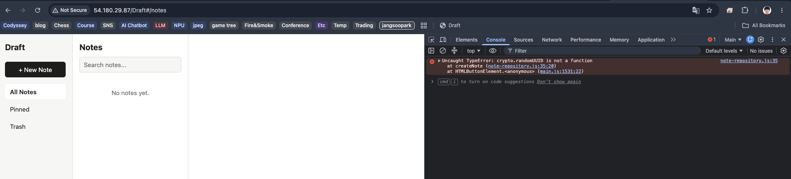

# Troubleshooting

### 노트 생성 오류: `crypto.randomUUID is not a function`

- **증상:** HTTP로 접속하면 노트 생성 시 브라우저 콘솔에서 `crypto.randomUUID` 오류가 발생함
- **원인:** `crypto.randomUUID()`는 보안 컨텍스트에서만 사용할 수 있음 [1]. 퍼블릭 IP를 통한 HTTP 접속은 보안 컨텍스트가 아님 [2].
- **해결:** Nginx에 SSL을 적용하고 HTTPS 주소로 접속
- **확인:** HTTPS에서 노트가 정상 생성되고 같은 콘솔 오류가 다시 발생하지 않는지 확인

### 결과

```javascript
note-repository.js:35 Uncaught TypeError: crypto.randomUUID is not a function
    at createNote (note-repository.js:35:20)
    at HTMLButtonElement.<anonymous> (main.js:1531:22)
createNote @ note-repository.js:35
(anonymous) @ main.js:1531'

```


#### 참고 자료

1. [MDN Web Docs — Crypto: randomUUID() method](https://developer.mozilla.org/en-US/docs/Web/API/Crypto/randomUUID)
2. [MDN Web Docs — Secure contexts](https://developer.mozilla.org/en-US/docs/Web/Security/Defenses/Secure_Contexts)

---

### 도메인 없이 공인 IP로 HTTPS 적용

- **상황:** 도메인이 없어 일반적인 도메인 기반 인증서를 사용할 수 없음
- **해결:** Let’s Encrypt의 IP 주소 인증서를 발급하고 Nginx에 직접 설정
- **조건:** Certbot 5.4 이상과 IP 인증서 발급 설정 필요
- **주의:** IP 인증서는 160시간(약 6일) 유효함. Nginx용 자동 설치 플러그인이 IP 인증서를 지원하지 않아 인증서 경로와 Nginx 설정을 직접 연결해야 함
- **후속 조치:** 자동 갱신과 갱신 후 Nginx 재적용 설정을 구성하고, 갱신이 동작하는지 확인

#### 참고 자료

1. [Let’s Encrypt — Six-Day and IP Address Certificates Available in Certbot](https://letsencrypt.org/2026/03/11/shorter-certs-certbot)
2. [Let’s Encrypt — Profiles](https://letsencrypt.org/docs/profiles/)

---
